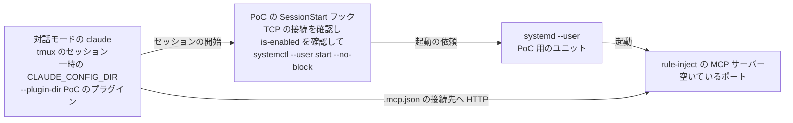

# プラグイン

## 現状

<!-- table: data -->

| 分類 | ページ / ファイル | 概要 | 補足 |
| --- | --- | --- | --- |
| ドキュメント | `dev/設計書/シナリオ/単一ユースケース/落ちていたMCPサーバーがセッションの開始時に起動される.yaml`（新規） | 応答しないサーバーを、セッションの開始時にユニットで起動するシナリオ | 新規作成 |
| ドキュメント | [dev/設計書/シナリオ/単一ユースケース/index.yaml](https://github.com/shuhei1101/rule-inject/blob/develop/dev/%E8%A8%AD%E8%A8%88%E6%9B%B8/%E3%82%B7%E3%83%8A%E3%83%AA%E3%82%AA/%E5%8D%98%E4%B8%80%E3%83%A6%E3%83%BC%E3%82%B9%E3%82%B1%E3%83%BC%E3%82%B9/index.yaml) | 単一ユースケースの目次 | 行を追加 |
| ドキュメント | [dev/設計書/シナリオ/単一ユースケース/端末をセットアップする.yaml](https://github.com/shuhei1101/rule-inject/blob/develop/dev/%E8%A8%AD%E8%A8%88%E6%9B%B8/%E3%82%B7%E3%83%8A%E3%83%AA%E3%82%AA/%E5%8D%98%E4%B8%80%E3%83%A6%E3%83%BC%E3%82%B9%E3%82%B1%E3%83%BC%E3%82%B9/%E7%AB%AF%E6%9C%AB%E3%82%92%E3%82%BB%E3%83%83%E3%83%88%E3%82%A2%E3%83%83%E3%83%97%E3%81%99%E3%82%8B.yaml) | global-setup のシナリオ | サービス名の受け取り方が案 A のとき更新 |
| ドキュメント | [dev/設計書/インターフェース定義/プラグイン/index.yaml](https://github.com/shuhei1101/rule-inject/blob/develop/dev/%E8%A8%AD%E8%A8%88%E6%9B%B8/%E3%82%A4%E3%83%B3%E3%82%BF%E3%83%BC%E3%83%95%E3%82%A7%E3%83%BC%E3%82%B9%E5%AE%9A%E7%BE%A9/%E3%83%97%E3%83%A9%E3%82%B0%E3%82%A4%E3%83%B3/index.yaml) | フックの入出力の目次 | 新しいフックのインターフェース定義の行を追加 |
| ドキュメント | [dev/設計書/インターフェース定義/プラグイン/既読の記録の掃除.py.yaml](https://github.com/shuhei1101/rule-inject/blob/develop/dev/%E8%A8%AD%E8%A8%88%E6%9B%B8/%E3%82%A4%E3%83%B3%E3%82%BF%E3%83%BC%E3%83%95%E3%82%A7%E3%83%BC%E3%82%B9%E5%AE%9A%E7%BE%A9/%E3%83%97%E3%83%A9%E3%82%B0%E3%82%A4%E3%83%B3/%E6%97%A2%E8%AA%AD%E3%81%AE%E8%A8%98%E9%8C%B2%E3%81%AE%E6%8E%83%E9%99%A4.py.yaml) | 既存の SessionStart のフック（`sweep_read`） | 新しいフックの入力・例外・ログの書き方の手本。変更しない |
| ドキュメント | [dev/設計書/インターフェース定義/プラグイン/端末のセットアップ.yaml](https://github.com/shuhei1101/rule-inject/blob/develop/dev/%E8%A8%AD%E8%A8%88%E6%9B%B8/%E3%82%A4%E3%83%B3%E3%82%BF%E3%83%BC%E3%83%95%E3%82%A7%E3%83%BC%E3%82%B9%E5%AE%9A%E7%BE%A9/%E3%83%97%E3%83%A9%E3%82%B0%E3%82%A4%E3%83%B3/%E7%AB%AF%E6%9C%AB%E3%81%AE%E3%82%BB%E3%83%83%E3%83%88%E3%82%A2%E3%83%83%E3%83%97.yaml) | global-setup の入出力 | サービス名の受け取り方が案 A のとき、サービス名の記載を追加 |
| ドキュメント | [dev/設計書/モジュール構成/hooks/index.yaml](https://github.com/shuhei1101/rule-inject/blob/develop/dev/%E8%A8%AD%E8%A8%88%E6%9B%B8/%E3%83%A2%E3%82%B8%E3%83%A5%E3%83%BC%E3%83%AB%E6%A7%8B%E6%88%90/hooks/index.yaml) | フックのモジュールの目次 | 新しいフックのモジュールの行を追加 |
| ドキュメント | [dev/設計書/モジュール構成/分類/プラグイン/フック.yaml](https://github.com/shuhei1101/rule-inject/blob/develop/dev/%E8%A8%AD%E8%A8%88%E6%9B%B8/%E3%83%A2%E3%82%B8%E3%83%A5%E3%83%BC%E3%83%AB%E6%A7%8B%E6%88%90/%E5%88%86%E9%A1%9E/%E3%83%97%E3%83%A9%E3%82%B0%E3%82%A4%E3%83%B3/%E3%83%95%E3%83%83%E3%82%AF.yaml) | フックの分類の構成 | 新しいフックを追加 |
| ドキュメント | [dev/設計書/モジュール構成/shared/logger.py.yaml](https://github.com/shuhei1101/rule-inject/blob/develop/dev/%E8%A8%AD%E8%A8%88%E6%9B%B8/%E3%83%A2%E3%82%B8%E3%83%A5%E3%83%BC%E3%83%AB%E6%A7%8B%E6%88%90/shared/logger.py.yaml) | ログの `Component`・`LogOperation` | 新しいフックの値を追加 |
| ドキュメント | [dev/設計書/モジュール構成/shared/settings.py.yaml](https://github.com/shuhei1101/rule-inject/blob/develop/dev/%E8%A8%AD%E8%A8%88%E6%9B%B8/%E3%83%A2%E3%82%B8%E3%83%A5%E3%83%BC%E3%83%AB%E6%A7%8B%E6%88%90/shared/settings.py.yaml) | 設定ファイルの読み取り | サービス名の受け取り方が案 A のとき、キーを追加 |
| ドキュメント | [dev/設計書/設定/プラグイン.yaml](https://github.com/shuhei1101/rule-inject/blob/develop/dev/%E8%A8%AD%E8%A8%88%E6%9B%B8/%E8%A8%AD%E5%AE%9A/%E3%83%97%E3%83%A9%E3%82%B0%E3%82%A4%E3%83%B3.yaml) | 環境変数と設定ファイルのキー | サービス名の受け取り方が案 A のとき、キーを追加 |
| ドキュメント | [dev/設計書/非機能要件/非機能要件.yaml](https://github.com/shuhei1101/rule-inject/blob/develop/dev/%E8%A8%AD%E8%A8%88%E6%9B%B8/%E9%9D%9E%E6%A9%9F%E8%83%BD%E8%A6%81%E4%BB%B6/%E9%9D%9E%E6%A9%9F%E8%83%BD%E8%A6%81%E4%BB%B6.yaml) | フックの実行時間（1 秒）ほか | 応答の確認の待ち時間の決定値を追加 |
| ドキュメント | [dev/設計書/ER図/ログ.yaml](https://github.com/shuhei1101/rule-inject/blob/develop/dev/%E8%A8%AD%E8%A8%88%E6%9B%B8/ER%E5%9B%B3/%E3%83%AD%E3%82%B0.yaml) | フックのログの列 | 新しいフックの `component`・`operation` の値を追加 |
| ドキュメント | [dev/設計書/アーキテクチャ図/アーキテクチャ図.yaml](https://github.com/shuhei1101/rule-inject/blob/develop/dev/%E8%A8%AD%E8%A8%88%E6%9B%B8/%E3%82%A2%E3%83%BC%E3%82%AD%E3%83%86%E3%82%AF%E3%83%81%E3%83%A3%E5%9B%B3/%E3%82%A2%E3%83%BC%E3%82%AD%E3%83%86%E3%82%AF%E3%83%81%E3%83%A3%E5%9B%B3.yaml) | サブシステムと境界 | フックから systemd --user を経て MCP サーバーを起動するつながりを追加 |
| 実装 | [hooks/hooks.json](https://github.com/shuhei1101/rule-inject/blob/develop/hooks/hooks.json) | フックの登録 | `SessionStart` にフックを追加 |
| 実装 | `src/rule_inject/hooks/` の新しいフックのモジュール（新規） | 応答の確認とユニットの起動の依頼 | ファイル名はモジュール構成設計で決める |
| 実装 | [src/rule_inject/shared/logger.py](https://github.com/shuhei1101/rule-inject/blob/develop/src/rule_inject/shared/logger.py) | ログ | `Component`・`LogOperation` に値を追加 |
| 実装 | [src/rule_inject/shared/settings.py](https://github.com/shuhei1101/rule-inject/blob/develop/src/rule_inject/shared/settings.py) | 設定ファイルの読み取り | サービス名の受け取り方が案 A のとき、キーを追加 |
| 実装 | [src/files.yaml](https://github.com/shuhei1101/rule-inject/blob/develop/src/files.yaml) | src の管理用の YAML | 新しいモジュールの行を追加 |
| テスト | [tests/files.yaml](https://github.com/shuhei1101/rule-inject/blob/develop/tests/files.yaml) | tests の管理用の YAML | 新しいテストの行を追加 |
| テスト | [tests/e2e/単一ユースケース/test_ended_session_records_cleaned.py](https://github.com/shuhei1101/rule-inject/blob/develop/tests/e2e/%E5%8D%98%E4%B8%80%E3%83%A6%E3%83%BC%E3%82%B9%E3%82%B1%E3%83%BC%E3%82%B9/test_ended_session_records_cleaned.py) | 既存の SessionStart のフックの E2E | 新しいシナリオの E2E の手本。実行のみ |

<!-- /table -->

## 変更方針

| 対象 | 方針 | 補足 |
| --- | --- | --- |
| 応答の確認 | `127.0.0.1` の `RULE_INJECT_PORT`（無ければ `8783`）へ TCP で接続し、接続できればサーバーが応答するとみなして何もしない | 接続の待ち時間は非機能要件に決定値を追加し、フックの実行時間（1 秒）の内に収める |
| 起動の依頼 | 接続できなければ `systemctl --user start --no-block {サービス名}` を実行し、待ち受けの開始を待たない | 起動するユニットの条件は要件.md の `未確定` |
| サービス名 | 要件.md の `未確定` の案で受け取る | 推奨は設定ファイルのキー（既定 `rule-inject`） |
| 起動しない端末 | `systemctl` が無い・ユニットが無い・ユーザーの systemd が動いていない端末では何もしない | ログには記載しない（補助の対象外の端末のため） |
| 失敗の扱い | `systemctl` が 0 以外で終わったとき・打ち切ったときは、ER 図「ログ」のログへ記載し、終了コード 0 で終える | 設定ファイルが読めないときは、既存の SessionStart のフックと同じく `read_settings` をログへ記載して何もしない |
| フックの出力 | 起動を依頼したときだけ、`/mcp` で接続し直す旨を `additionalContext` で返す。それ以外の経路では何も出さない | 起動を依頼したセッションは最初の接続に間に合わない（`## PoC 結果`）。案内の文面はインターフェース定義設計で決める |
| フックの依存 | 標準ライブラリだけで実装する | 既存のフックと同じ（分類『フック』） |
| 既存の SessionStart のフック | `work_rules`・`sweep_read` は変えない | E2E を実行のみで回す |

起動したセッション自身がサーバーへ接続できるか（PoC 検証で確定: 案 B。[確認ログ](./確認ログ.md)）

Claude Code が SessionStart のフックと MCP サーバーへの接続をどの順で行うか、接続に失敗したサーバーへ同じセッションで接続し直すかは、公式のドキュメントに記載が無い。
PoC 検証で、サーバーを止めた状態から `claude` を起動し、SessionStart のフックで `systemctl --user start --no-block` を依頼したとき、同じセッションの `/mcp` の接続の状態と、ツールを呼べるまでの時間を測る。

| 案 | 内容 | メリット | デメリット |
| --- | --- | --- | --- |
| A | 同じセッションで接続できるなら、フックは何も出さない | 案内の文が増えない | - |
| B | 同じセッションで接続できないなら、起動を依頼したときだけ `/mcp` で接続し直す旨を `additionalContext` へ記載する | 利用者とエージェントが接続し直す方法を知る | 起動を依頼したセッションでは、案内の文がコンテキストに入る |

決定: B

PoC 検証で、起動を依頼したセッションは 10 回とも最初の接続に間に合わず、`/mcp` の接続し直しでツールを使用できた（`## PoC 結果`）。

### PoC 検証の方針

#### リスク仮説

SessionStart のフックで systemd --user にサーバーの起動を依頼しても、Claude Code の接続の待ちの間にサーバーが待ち受けを始めなければ、起動を依頼したセッションでは MCP のツールを使用できず、Issue の「セッションを開いてもツールを使用できない」がそのセッションでは解消しない。
そのときは、フックの出力（`/mcp` で接続し直す案内）と `.mcp.json` の `alwaysLoad` の要否が要件として変わる。
また、`systemctl --user` の呼び出しを含むフックが非機能要件「フックの実行時間」（1 秒）の内で終わらなければ、フックが打ち切られる。

#### 検証構成

- 使用するもの: Claude Code CLI（端末の 2.1.318）、systemd --user（この端末で `running`）、develop の `python -m rule_inject.server`
- 構成 1〜3 は、対話モードの `claude` を tmux のセッション `rule-inject-poc-112-claude` で起動し、`tmux capture-pane` で `/mcp` の表示を参照して測る。サーバーを止めた状態から 5 回ずつ実行する
  - 構成 1: `alwaysLoad` なし
  - 構成 2: `alwaysLoad: true`
  - 構成 3: フックなし（サーバーを止めたまま。比較の基準）
- フックの実行時間は、`python3 hooks/run.py {PoC のフック}` を起動から終了まで 1,000 回測る。サーバーが応答する経路と、応答せずに `is-enabled` と `start --no-block` まで進む経路の両方を測る
- PoC 用のユニットは `rule-inject-poc-112.service` の名前で一時に配置し、空いているポートを `RULE_INJECT_PORT` で指定する。検証後に `disable` して削除する

| 本番との違い | 同じセッションの接続の結論に影響するか | 補い方 |
| --- | --- | --- |
| `--plugin-dir` で読み込んだプラグイン（本番はマーケットプレースから入れたプラグイン） | 影響する余地がある。フックと `.mcp.json` を参照する順がプラグインの入れ方で変わると、接続の待ちの始まりが変わる | 構成 1 のうち 1 回を、一時の `CLAUDE_CONFIG_DIR` へローカルのマーケットプレースから入れたプラグインで実行し、結果が他の回と同じかを記録する |
| 一時のユニット名とポート（本番は `rule-inject` と `8783`） | 影響しない。名前とポートは起動と接続の時間に関わらない | - |
| 一時の `CLAUDE_CONFIG_DIR` | 影響しない。端末の設定に `MCP_CONNECT_TIMEOUT_MS` が無く、接続の待ちは既定の値のまま | 実行の前に `env` に `MCP_CONNECT_TIMEOUT_MS` が無いことを確認する |

#### 成功条件

| 観点 | 基準 |
| --- | --- |
| フックの実行時間 | 2 つの経路のそれぞれで、1,000 回の p99.9 に余裕 50% を加えた値が 1 秒未満（非機能要件「フックの実行時間」と同じ測り方） |
| 起動の依頼 | 構成 1・2 の 5 回とも、セッションの開始からサーバーが待ち受けを始めるまで（`ss -ltnH`）が 24 秒以内。接続の待ちの上限 30 秒（`MCP_CONNECT_TIMEOUT_MS` の未設定の値。上の実測）から安全率 20% を引いた値 |
| 接続し直し | 同じセッションで呼べなかったときに、`/mcp` の接続し直しでツールを呼べる |

同じセッションの接続は、次の時刻を記録し、成立・不成立ではなく案 A・B を決める材料にする。

| 構成 | 記録する時刻 |
| --- | --- |
| 構成 1・2 | セッションの開始・サーバーが待ち受けを始めた時刻・`/mcp` に接続できた状態が表示された時刻（または失敗の表示の時刻） |
| 構成 3 | セッションの開始・`/mcp` が失敗の表示になった時刻 |

構成 3 の失敗までの時間より、構成 1・2 の待ち受けの開始が早く、5 回とも接続できたときは案 A、それ以外は案 B にする。
フックの実行時間・起動の依頼・接続し直しのどれかが基準を満たさないときは、PoC 不成立として要件の見直しを出す。

## 設計書の確定コミット

| 工程 | 範囲 | 補足 |
| --- | --- | --- |
| 単一ユースケース設計 | `6bb6d53..ecfceda` | - |

## PoC 結果

| 検証構成 | 成功条件 | 結果 | PoC PR | 補足 |
| --- | --- | --- | --- | --- |
| フックの実行時間（応答する経路） | p99.9 + 余裕 50% が 1 秒未満 | ✅ 296 ms | [#113](https://github.com/shuhei1101/rule-inject/pull/113) | 1,000 回。p50 72 ms・p99.9 197 ms |
| フックの実行時間（起動を依頼する経路） | p99.9 + 余裕 50% が 1 秒未満 | ✅ 553 ms | [#113](https://github.com/shuhei1101/rule-inject/pull/113) | 1,000 回。p50 120 ms・p99.9 369 ms |
| 起動の依頼（構成 1・2 の 10 回） | セッションの開始から待ち受けまで 24 秒以内 | ❌ 最大 26.0 秒 | [#113](https://github.com/shuhei1101/rule-inject/pull/113) | 9.3〜26.0 秒。10 回とも起動はした |
| 同じセッションの接続（構成 1・2） | 記録のみ（案 A・B の材料） | 0 / 10 回 | [#113](https://github.com/shuhei1101/rule-inject/pull/113) | `alwaysLoad` の有無で差は無い |
| 接続し直し | `/mcp` の接続し直しでツールを呼べる | ✅ | [#113](https://github.com/shuhei1101/rule-inject/pull/113) | `Reconnected` と表示され、ツールの一覧を受け取った |

結論: 不成立。

起動の依頼の基準を 1 回超えたうえ、同じセッションでは 10 回とも接続できなかった。
Claude Code は接続を拒まれると、1 秒・2 秒・4 秒の間隔で 3 回だけ接続し直し、セッションの開始から 8.1〜11.4 秒で諦める（構成 3 も同じ）。
`Starting connection with timeout of 30000ms` の 30 秒は 1 回の接続の上限で、拒まれたときの待ちではなかった。
サーバーが待ち受けを始めたのはセッションの開始から 9.3 秒以降（フックの終了から 7.0〜21.4 秒）で、どの回も諦めた後だった。
フックの実行時間は Claude Code の記録では 557〜2,142 ms で、セッションの開始の負荷で Python の起動が遅れても打ち切られずに終わった。

最小再現の要点は [start_server.py](https://github.com/shuhei1101/rule-inject/blob/72afb83/poc/start_server.py) の `main` の分岐（TCP の接続の確認 → `systemctl --user is-enabled` → `start --no-block`）。
PR の差分の見どころは `poc/results/connection-attempts.log`（接続の試行と諦めた時刻）と `poc/results/*.result.json`（待ち受けの開始の時刻）。

## テスト結果

### 単体

なし

### 結合

なし
