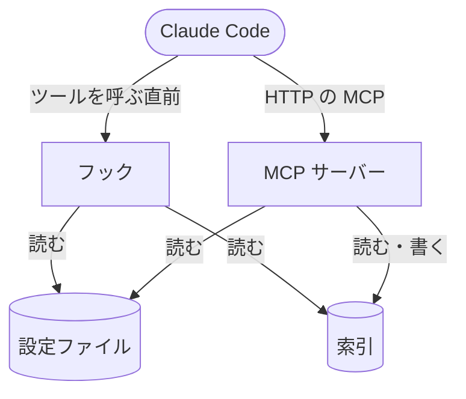

# MCPサーバー

ローカルで常駐させる MCP サーバーの役割と、フックとの関係

ローカルのクローンから 1 つだけ常駐させ、プラグインの `.mcp.json` の接続先へ HTTP で接続する MCP サーバー。
有効なルールの確認・ルールの検索・索引のチェックと編集・既読の記録の確認と削除と、サーバー自身の状態の確認・再起動・更新を、Claude Code のツールとして使用できる。
起動の手順は [セットアップ](セットアップ.md)、ツールの引数と応答は [MCPツール](MCPツール.md)。

## フックとの関係

フックはサーバーに依存せず、索引を自分で読んで案内する。
サーバーが止まっていても、案内・既読の記録・掃除は変わらず動く。
サーバーはフックと同じ照合のコードで索引を読み、同じ結果を返却する。
セッションの開始時にサーバーが応答しなければ、フックが systemd のユーザーのユニットへ起動を依頼し、`/mcp` で接続し直すよう案内する。
新しいファイルを空で作ってから中身を記載する決まりと、どの作業でこのサーバーのツールを呼び、どの作業で grep・Read を使用するかの使い分けは、サーバーが接続時の instructions で届ける。
サーバーが止まっている間は、この決まりと使い分けは届かない。

## ツール

<!-- table: data -->

| ツール | できること |
| --- | --- |
| `list_rules` | プロジェクトで今有効なルールと、読めなかった索引・読み飛ばしたエントリ・無効のエントリを返却する |
| `search_rules` | ファイルのパスか MCP のツールの呼び出しにヒットするルールと、未読のときに操作を止めるかを返却する |
| `check_indexes` | 索引を JSON Schema に照らし、違反と、`rule` の場所にファイルが無いエントリと、`paths` がプロジェクトのどのファイルにもヒットしないエントリと、dev-docs の使われているどのタグにもヒットしないタグのパターンを返却する。使われているタグは dev-docs へ問い合わせて引き、届かないときはこの確認だけを飛ばす |
| `write_index_entry` | 索引のエントリを新規作成・編集する |
| `delete_index_entry` | 索引のエントリを削除する |
| `get_read_records` | セッションの既読のルールと、今の本文が既読にした時点と同じか、読んだ方法を返却する。セッションを省くと、既読の記録のあるセッションの一覧を返却する |
| `delete_read_records` | セッションの既読の記録と案内済みの記録を削除し、ルールを未読に戻す |
| `get_server_status` | サーバーのポート・プロセス・起動した時刻・バージョン・クローンの commit と、設定ファイルを読めるかを返却する |
| `reload_settings` | 設定ファイルを読み直し、読めたかと読んだ値を返却する |
| `restart_server` | 処理中の呼び出しの終わりを待ってから、同じプロセスのまま起動し直す |
| `update_server` | クローンへ上流の commit を取り込み、依存を入れ直して起動し直す。設定の移し替えが要るときは起動し直さず、`global-setup` を案内する |

<!-- /table -->

編集のツールは、記載した後の索引に新しい問題が出るときは書き込まない。
コメント・キーの並び・引用符は保ったまま書き換える。
書き込める索引は、設定ファイルで読む索引だけ。

## 動き方

- 待ち受けるアドレスは `127.0.0.1` だけ。ポートは環境変数 `RULE_INJECT_PORT` で決める（[環境変数](環境変数.md)）
- 設定ファイルと索引は、ツールを呼ぶたびに読み直す。修正した内容は、再起動せずに次のツールの呼び出しとフックの呼び出しから有効になる。ポートだけは起動時に 1 回読む
- 呼び出しをまたぐ状態は、再起動を始めたか・更新が動いているか・処理中の呼び出しの数だけを持つ。1 つのサーバーを複数のセッションが共有する
- 再起動と更新の再起動は、処理中の呼び出しの終わりを待ってから待ち受けを閉じ、同じプロセスのまま起動し直す。待つ間は `get_server_status` 以外のツールを断る。接続は切れるので、Claude Code は `/mcp` で接続し直す
- 確認と削除のツールだけが既読の記録を読み・削除し、追加しない。`search_rules` は全て未読とみなした結果を返却する
- `check_indexes` は、`paths` のヒットしないエントリを確認するために `project_dir` の下のファイルを辿る。1 回の呼び出しで辿る時間は 30 秒までで、超えたときは続きの位置（`next_cursor`）を返却し、`cursor` に指定して呼び直すと続きから辿る
