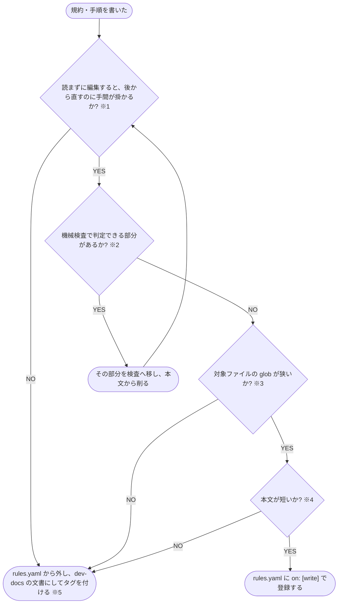

# ルールにするか文書にするかを決める

規約・手順を索引へ登録して注入するか、dev-docs の文書にしてタグで参照させるかを決める判定フローチャート

| 注 | 内容 |
| --- | --- |
| ※1 読まずに編集すると手間が掛かる | 書式・AI の既定と逆の独自の決まり・安全に関わる決まりで、読まずに編集すると後から修正する手間が掛かる |
| ※2 機械検査 | lint・スキーマ・型検査 |
| ※3 glob が狭い | 特定のファイル名・フォルダを指す glob。拡張子だけの glob は、全言語共通の規約 1〜2 件に限る |
| ※4 短い | 1 ルール 4KB 以内で、1 ファイルの編集でヒットするルールの合計が 10KB 以内。テンプレートは例外 |
| ※5 dev-docs | リポジトリの文書を配信し、タグで検索して参照させるサーバー（[shuhei1101/dev-docs](https://github.com/shuhei1101/dev-docs)） |
