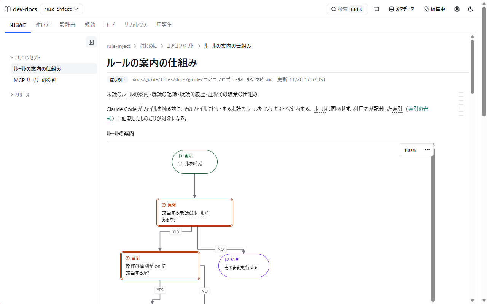
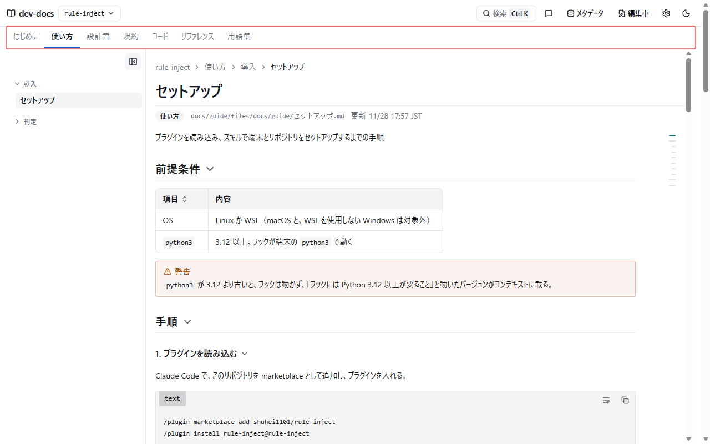
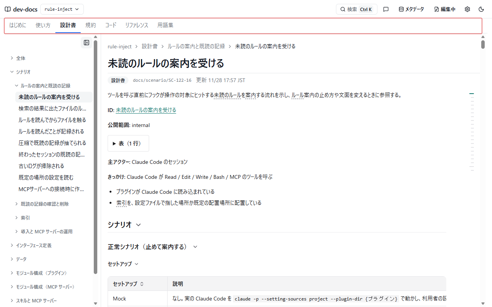
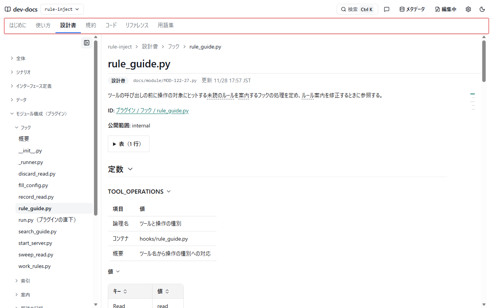
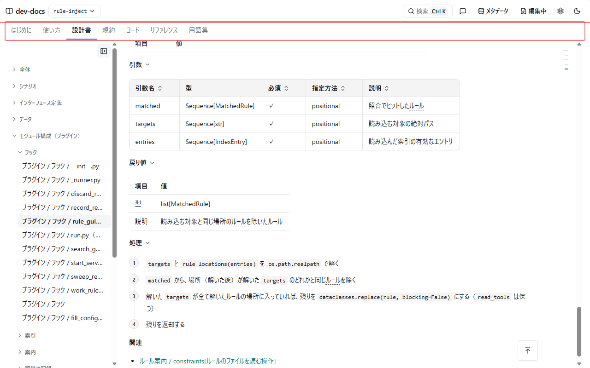
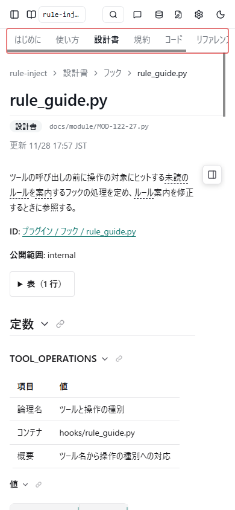
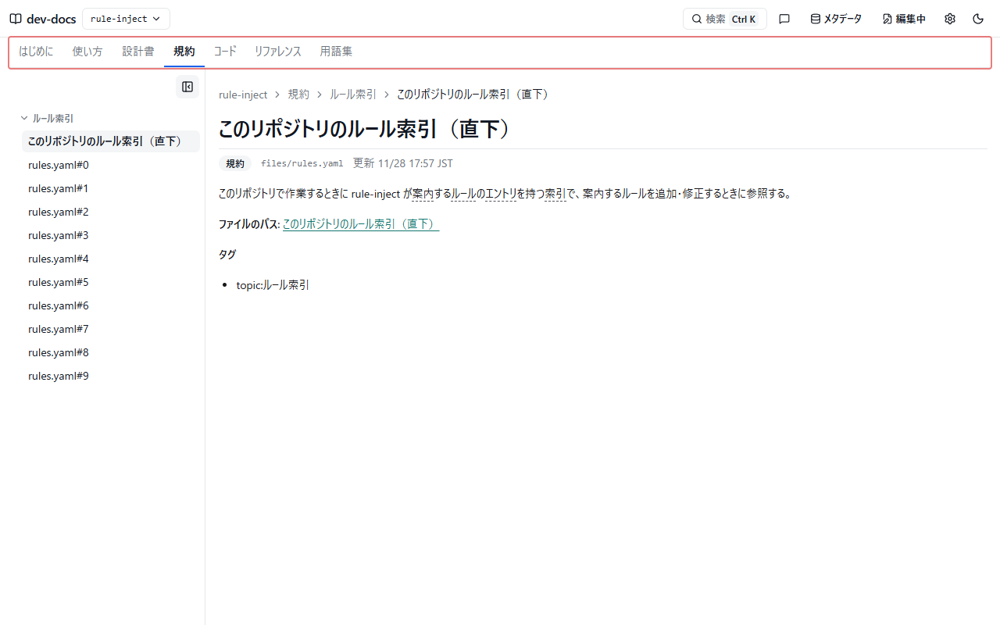
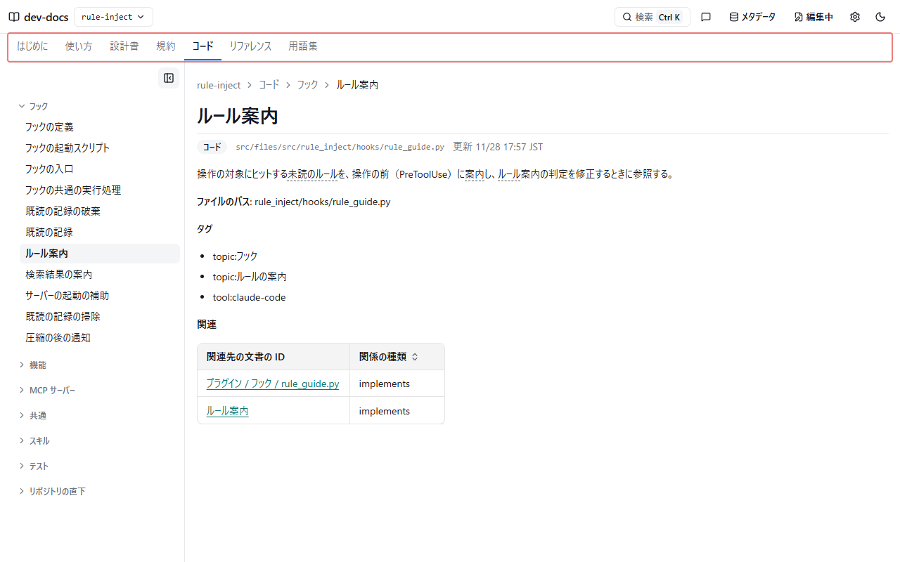
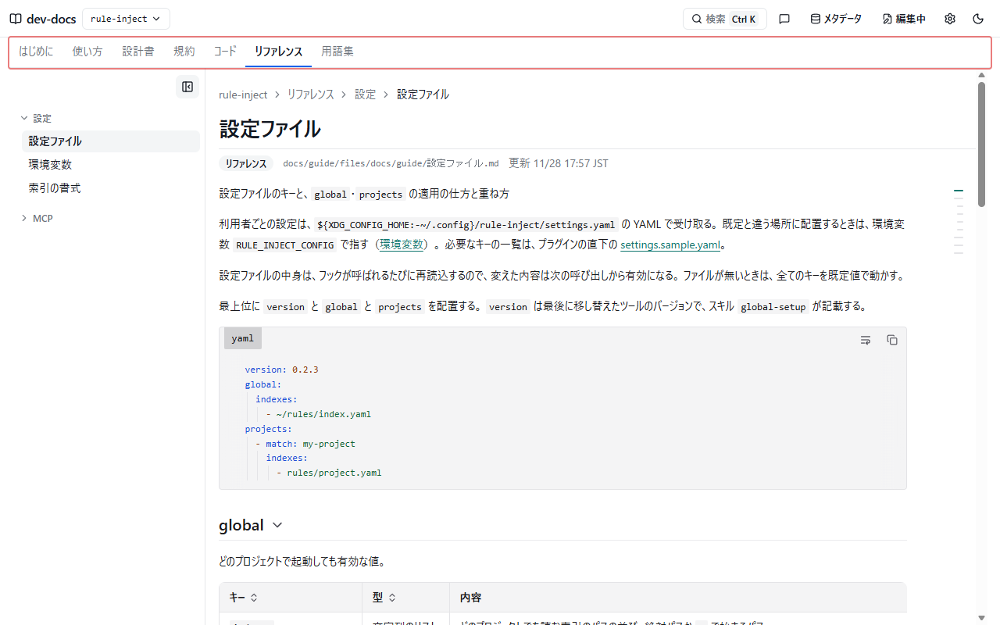
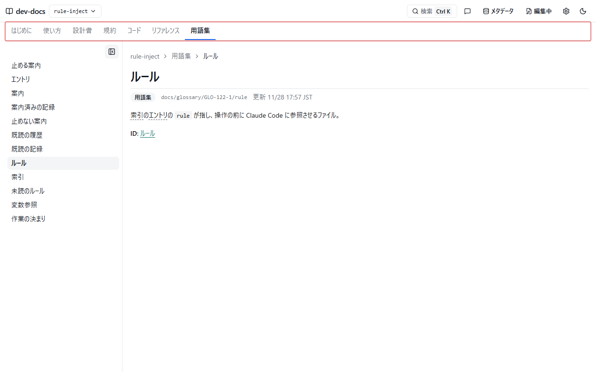

# 画面の確認

## 実装

作業ブランチの `project-index.yaml` を読む project-index（`storage: disk`）と dev-docs を一時に起動し、Edge で撮影した。
突き合わせた規約は knowledge の `dev-docs-navigation`（`tab-01`・`tab-02`・`sidebar-01`・`sidebar-02`・`index-01`）。

| 場面 | 画面幅 | 画像 | 確認した内容 |
| --- | --- | --- | --- |
| はじめに | 1280x800 |  | タブが 7 件で、はじめに・使い方・設計書・規約・コード・リファレンス・用語集の順。コアコンセプト・リリースのグループ |
| 使い方 | 1280x800 |  | 導入・判定のグループ |
| 設計書（シナリオ） | 1280x800 |  | 設計書の種類がタブでなくグループ。シナリオの下に機能の単位の 2 階層目 |
| 設計書（モジュール構成） | 1280x800 |  | フィーチャーごとのグループで、概要を先頭にファイル名を並べる |
| 設計書（モジュール構成・スクロール） | 1280x800 |  | 本文をスクロールしてもタブのバーとサイドバーが重ならない |
| 設計書（モジュール構成） | 390x844 |  | スマホ幅ではタブのバーが横にスクロールする |
| 規約 | 1280x800 |  | ルール索引のグループ |
| コード | 1280x800 |  | フック・機能・MCP サーバー・共通・スキル・テスト・リポジトリの直下のグループ |
| リファレンス | 1280x800 |  | 設定・MCP のグループ |
| 用語集 | 1280x800 |  | 用語を名前の順に並べる |

どのタブにも、フォルダの目次（`kind: index`）は並ばない。

あわせて、公開ドキュメントの行（`documents[].id: docs`）の `exclude` の `"*.yml"` が `docs/guide/files.yml` 自身に当たり、公開ドキュメントが 1 件も配信されていなかったのを直した（`category` も `metadata` に加えた）。

## テスト結果

結合テストの層（TL-2）の実行範囲を判定フローチャート『結合テストの実行範囲』と `judge_integration_scope` で判定した。
変更したファイル（`project-index.yaml`・`docs/pr/223/` の PR ドキュメント）はどれも R7 で、`tests/`・`src/` に `project-index.yaml` を参照する箇所が無いため、関係する結合テストは無い。
単体テストも、変更がコードに触れないため対応するテストが無い。
