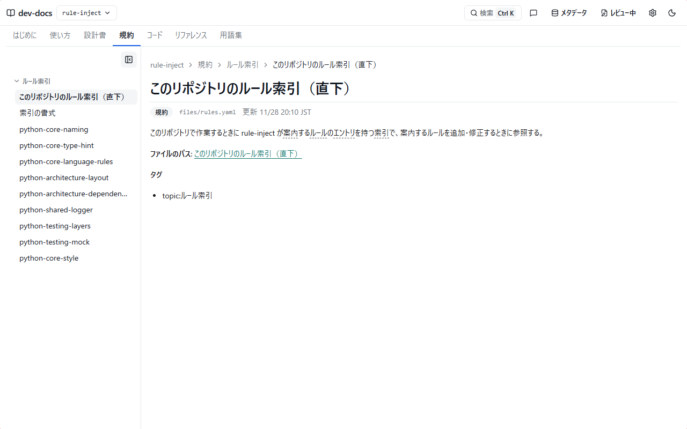
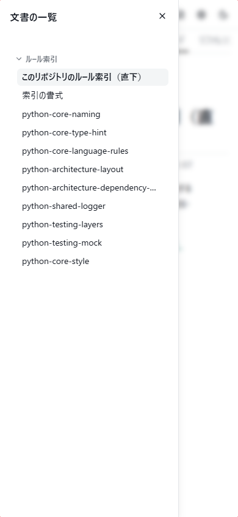

# MCP サーバー

## 現状

| 分類 | ページ / ファイル | 概要 | 補足 |
| --- | --- | --- | --- |
| 実装 | [src/rule_inject/features/index/check/index.schema.yaml](https://github.com/shuhei1101/rule-inject/blob/develop/src/rule_inject/features/index/check/index.schema.yaml) | 索引のスキーマ。エントリは `additionalProperties: false` | 名前を追加 |
| ドキュメント | [docs/interface/IF-122-2.py.yaml](https://github.com/shuhei1101/rule-inject/blob/develop/docs/interface/IF-122-2.py.yaml) | `write_index_entry` | 引数に名前 |
| ドキュメント | [docs/interface/IF-122-7.py.yaml](https://github.com/shuhei1101/rule-inject/blob/develop/docs/interface/IF-122-7.py.yaml) | `list_rules` | 応答に名前 |
| ドキュメント | [docs/interface/IF-122-11.py.yaml](https://github.com/shuhei1101/rule-inject/blob/develop/docs/interface/IF-122-11.py.yaml)・[docs/interface/IF-122-24.py.yaml](https://github.com/shuhei1101/rule-inject/blob/develop/docs/interface/IF-122-24.py.yaml) | 索引のチェック・エントリの検査 | 名前を受け付ける |
| ドキュメント | [docs/module/MOD-122-11.py.yaml](https://github.com/shuhei1101/rule-inject/blob/develop/docs/module/MOD-122-11.py.yaml)・[MOD-122-12](https://github.com/shuhei1101/rule-inject/blob/develop/docs/module/MOD-122-12.py.yaml)・[MOD-122-43](https://github.com/shuhei1101/rule-inject/blob/develop/docs/module/MOD-122-43.py.yaml)・[MOD-122-44](https://github.com/shuhei1101/rule-inject/blob/develop/docs/module/MOD-122-44.py.yaml) | エントリの編集・ツール・応答の型 | 名前を追加 |
| 設定 | [rules.yaml](https://github.com/shuhei1101/rule-inject/blob/develop/rules.yaml) | このリポジトリの索引 | 10 件に名前を記載 |

## 変更方針

| 対象 | 方針 | 補足 |
| --- | --- | --- |
| スキーマ | エントリの `properties` に `minLength: 1` の文字列の名前を加える（必須にしない） | - |
| エントリの編集 | `write_index_entry` で名前を書き込み・外せる | - |
| 一覧 | `list_rules` のエントリに名前を返す（無ければ省く） | - |
| rules.yaml | ルールのファイル名から拡張子を除いた名前（例: `python-core-naming`）を記載する | 先頭で見分けられる |
| 反映 | プラグインは develop を自動で取り込むため、反映作業を作らない | - |

## 設計書の確定コミット

| 工程 | 範囲 | 補足 |
| --- | --- | --- |
| 単一ユースケース設計 | `b4fd083..4fe7822` | - |
| 単一ユースケース設計 | `4fe7822..9b31bd5` | レビューの指摘の修正 |
| インターフェース定義設計 | `ea0868a..a853ae0` | - |
| モジュール構成設計 | `709344e..a535fc8` | - |
| モジュール構成設計 | `244658b..ceca696` | レビューの提案の反映（`test_load_validator` の条件） |

## 実装

| 項目 | 内容 |
| --- | --- |
| 撮った画面の場面 | テスト実行方法の補足「画面の起動」で作業ブランチの `project-index.yaml` から開いた dev-docs の `rule-inject/rules.yaml`（タブ「規約」）のサイドバー（`1280x800`。`390x844` は左上のボタンで「文書の一覧」を開いた状態） |

`rules.yaml` の 10 件のエントリは、サイドバーに `name` のとおりの互いに異なる名前で出る。
最も長い `python-architecture-dependency-management` は末尾が省略されるが、省略の前の `python-architecture-dependen` で `python-architecture-layout` と見分けられる。

## テスト結果

### 結合テストの実行範囲

| 変更したファイル | 結果 | 実行する結合テスト | 結合テストが無いエントリーポイント |
| --- | --- | --- | --- |
| `src/rule_inject/features/index/_yaml.py` | R7（`parse_index` は索引を読む全てのフックとツールが使用する。索引を読み込むテストを調べた） | `tests/integration/plugin/test_rule_guide.py` `tests/integration/plugin/test_search_guide.py` `tests/integration/plugin/test_record_read.py` `tests/integration/server/test_list_rules.py` `tests/integration/server/test_search_rules.py` `tests/integration/server/test_check_indexes.py` `tests/integration/server/test_write_index_entry.py` `tests/integration/server/test_delete_index_entry.py` `tests/integration/server/test_validate_entry.py` | - |
| `src/rule_inject/features/index/check/index.schema.yaml` | R7（スキーマの検査を使用するテストを調べた） | `tests/integration/server/test_check_indexes.py` `tests/integration/server/test_write_index_entry.py` `tests/integration/server/test_validate_entry.py` | - |
| `src/rule_inject/features/index/edit/service.py` | R7（エントリの編集を使用するテストを調べた） | `tests/integration/server/test_write_index_entry.py` `tests/integration/server/test_delete_index_entry.py` | - |
| `src/rule_inject/server/tools.py` | R7（変えたのは `list_rules` の `_rule_entry` だけ） | `tests/integration/server/test_list_rules.py` | - |
| `src/rule_inject/server/types.py` | R7（変えたのは `RuleEntry` だけで、`list_rules` の応答にだけ使用する） | `tests/integration/server/test_list_rules.py` | - |
| `rules.yaml` | R7（結合テストはテストごとの一時の索引を使用し、リポジトリの `rules.yaml` を参照しない） | - | - |
| `tests/unit/**`（4 ファイル） | R7（単体テストで、結合テストから参照しない） | - | - |
| `docs/**`（設計書・公開ドキュメント・PR ドキュメント・ログ） | R7（文書で、結合テストから参照しない） | - | - |
| 作る予定の結合テスト | IF-122-2・IF-122-7・IF-122-24 の `test_file` | `tests/integration/server/test_write_index_entry.py::test_normal_when_entry_name_written` `tests/integration/server/test_list_rules.py::test_normal_when_entry_has_name` `tests/integration/server/test_validate_entry.py::test_normal_when_entry_has_name` `tests/integration/server/test_validate_entry.py::test_normal_when_name_empty` | - |

### 単体

| ファイル | メソッド | 変更種別 | 結果 | 補足 |
| --- | --- | --- | --- | --- |
| `tests/unit/rule_inject/features/index/check/test_service.py` | `test_load_validator` | 変更 | ✅ | 条件のエントリに `name` を追加 `テスト結果/20261128201039_fc48bce_単体テスト.log` |
| `tests/unit/rule_inject/features/index/edit/test_service.py` | `test_write_entry_when_name_added` | 新規 | ✅ | 実装の前から pass（`_insert_position` が `ENTRY_KEY_ORDER` に無いキーを末尾に記載する。5d7df8a） `テスト結果/20261128201039_fc48bce_単体テスト.log` |
| `tests/unit/rule_inject/server/test_tools.py` | `test_list_rules_when_entry_has_name` | 新規 | ✅ | `テスト結果/20261128201039_fc48bce_単体テスト.log` |

### ドキュメント修正

『索引の書式』『MCP ツール』は公開ドキュメントで、規約『V字モデル』の対応表で対応する単体・結合テストが無いため実行していない。
