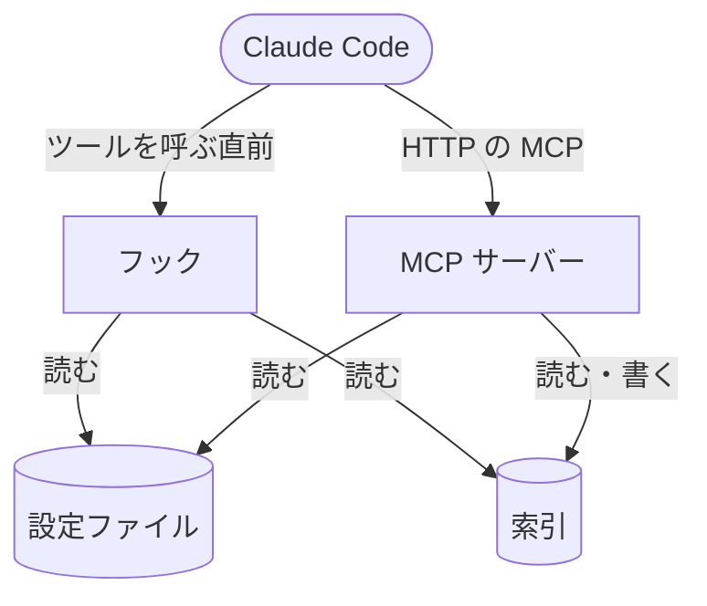

# MCPサーバー

ローカルで常駐させる MCP サーバーの役割と、フックとの関係

ローカルのクローンから 1 つだけ常駐させ、HTTP で接続する MCP サーバー。
効いているルールの確認・ルールの検索・索引のチェックと編集・既読の記録の確認と削除を、Claude Code のツールとして使える。
起動と登録の手順は [セットアップ](../../使い方/セットアップ.md)、ツールの引数と応答は [MCPツール](../../リファレンス/MCPツール.md)。

## フックとの関係

フックはサーバーに依存せず、今までどおり索引を自分で読んで案内する。
サーバーが止まっていても、案内・既読の記録・掃除は変わらず動く。
サーバーはフックと同じ照合のコードで索引を読み、同じ結果を返す。

## ツール

<!-- table: data -->

| ツール | できること |
| --- | --- |
| `list_rules` | プロジェクトで今効いているルールと、読めなかった索引・読み飛ばしたエントリ・無効のエントリを返す |
| `search_rules` | ファイルのパスか MCP のツールの呼び出しに当たるルールと、未読のときに操作を止めるかを返す |
| `check_indexes` | 索引を JSON Schema に照らし、違反と、`rule` の場所にファイルが無いエントリと、`paths` がプロジェクトのどのファイルにも当たらないエントリと、dev-docs の使われているどのタグにも当たらないタグのパターンを返す。使われているタグは dev-docs へ問い合わせて引き、届かないときはこの確かめだけを飛ばす |
| `write_index_entry` | 索引のエントリを新規作成・編集する |
| `delete_index_entry` | 索引のエントリを削除する |
| `get_read_records` | セッションの既読のルールと、今の本文が既読にした時点と同じか、読んだ方法を返す。セッションを省くと、既読の記録のあるセッションの一覧を返す |
| `delete_read_records` | セッションの既読の記録と案内済みの記録を削除し、ルールを未読に戻す |

<!-- /table -->

編集のツールは、書いた後の索引に新しい問題が出るときは書き込まない。
コメント・キーの並び・引用符は保ったまま書き換える。
書き込める索引は、設定ファイルで読む索引だけ。

## 動き方

- 待ち受けるアドレスは `127.0.0.1` だけ。ポートは設定ファイルの `global.server_port` か環境変数 `RULE_INJECT_PORT` で決める（[設定ファイル](../../リファレンス/設定ファイル.md)・[環境変数](../../リファレンス/環境変数.md)）
- 設定ファイルと索引は、ツールを呼ぶたびに読み直す。直した内容は、再起動せずに次のツールの呼び出しとフックの呼び出しから効く。ポートだけは起動時に 1 回読む
- 呼び出しをまたぐ状態を持たない。1 つのサーバーを複数のセッションが共有する
- 確認と削除のツールだけが既読の記録を読み・削除し、書き足さない。`search_rules` は全て未読とみなした結果を返す
- `check_indexes` は、`paths` の当たらないエントリを確かめるために `project_dir` の下のファイルを辿る。1 回の呼び出しで辿る時間は 30 秒までで、超えたときは続きの位置（`next_cursor`）を返し、`cursor` に渡して呼び直すと続きから辿る
