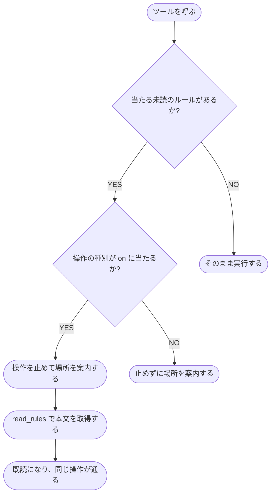

# ルールの案内

未読のルールの案内・既読の記録・圧縮での破棄の仕組み

Claude Code がファイルを触る前に、そのファイルに当たる未読のルールをコンテキストへ案内する。
ルールは同梱せず、利用者が書いた索引（[索引の書式](../../リファレンス/索引の書式.md)）に載せたものだけが対象になる。

## 案内

`PreToolUse` フックが、ツールを呼ぶ直前に、操作の対象のパスかツール名を索引と照らす。
当たるルールのうち、そのセッションで未読のものを案内する。

| 操作の種別 | 対象のツール |
| --- | --- |
| `read` | Read、ファイルを指す Grep、Bash の読むコマンド（`cat` `head` `tail` `less` `more` `grep` `rg` `sed` `awk` `wc` `bat`） |
| `write` | Edit、Write、NotebookEdit |
| `mcp` | MCP のツール |

- 操作の種別がエントリの `on` に当たるときは、操作を止めて、ルールの場所と本文の読み方（`read_rules`）を案内する。本文を読んだ後に、同じ操作をやり直す
- `on` に当たらないときは、止めずに案内する。案内には「やり直す」を含めない
- 止めない案内は、ルールごとにセッションで 1 回だけ出す。案内した場所はセッションごとの案内済みの記録（`{session_id}.guided.txt`）に足す
- 同じルールに複数のエントリが当たっても、案内と止めるかの判定はルールごとに 1 つにまとめる
- 案内が 10,000 字を超えるときは、止めるルールを先に並べて収まる分だけ載せ、載せきれなかった件数を末尾に添える。残りは未読のままなので、やり直したときに案内される

新しいファイルは、空で作ってから中身を書く。
空で作った時点で当たるルールが案内されるため、本文を読んでから書ける。
`SessionStart` フックが、この決まりをセッションの開始時にコンテキストへ載せる。

## 検索結果への案内

Grep・Glob・検索の Bash（`grep` `rg` `find` `ls`）を呼んだ直後に、`PostToolUse` フックが結果に出た実在するファイルを索引と照らす。
当たるルールのうち、そのセッションで未読で、まだ案内していないものを、読むかは任意と伝えて止めずに案内する。
照合するのは結果の先頭から 100 件までで、超えた分の件数は案内に添える。

## 本文の取得

案内に載った場所は、MCP のツール `read_rules` に渡して本文を受け取る（[MCPツール](../../リファレンス/MCPツール.md)）。
`session_id` は、呼び出しの直前に `PreToolUse` フックが引数へ足す。

`read_rules` は、ルールの場所の代わりに、これから触るファイルのパスを受けて、当たるルールの本文をまとめて返すこともできる。

## 既読の記録

本文を返した場所は、セッションごとの記録ファイル（[環境変数](../../リファレンス/環境変数.md)の `RULE_INJECT_STATE_DIR`）へ 1 行ずつ追記する。
フックと MCP サーバーが同じファイルを読み書きする。

Read か Bash の `cat` `bat` `less` `more` で、索引に載ったルールのファイルを読んだときも、`PostToolUse` フックが同じ記録へ場所を足す。

## 圧縮での破棄

会話が圧縮されると、読んだ本文がコンテキストから消える。
`PreCompact` フックが、圧縮の前にそのセッションの記録ファイルと案内済みの記録を捨てる。
消えたルールは、次に当たったときにまた案内される。

圧縮しないまま終わったセッションの記録ファイルは、終わった後も残る。
Claude Code は終えたセッションも会話の保持期間（既定で 30 日）のあいだ再開でき、再開したセッションは読んだ本文を文脈に持ったまま続くため、記録も同じ期間は残す。
`SessionStart` フックが、セッションの開始時に、最後に書き足してから 30 日を過ぎた記録ファイルと案内済みの記録を消す。

## 案内できないとき

- 索引が読めない・記録ファイルが読めないときは、操作を止めずに、場所と理由をコンテキストへ載せる
- フックの実行が 1 秒を超えると、Claude Code がフックを打ち切り、案内なしで通常の流れへ進む
