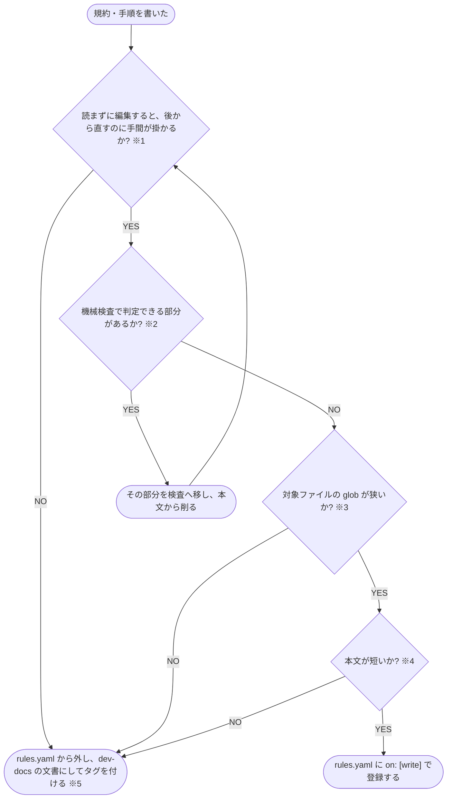

# ルールにするか文書にするかを決める

規約・手順を rules.yaml へ登録して注入するか、dev-docs の文書にしてタグで読ませるかを決める判定フローチャート

- **※1 読まずに編集すると手間が掛かる**: 書式・AI の既定と逆の独自の決まり・安全に関わる決まりで、読まずに編集すると後から直す手間が掛かる
- **※2 機械検査**: lint・スキーマ・型検査
- **※3 glob が狭い**: 特定のファイル名・フォルダで引く glob。拡張子だけの glob は、全言語共通の規約 1〜2 件に限る
- **※4 短い**: 1 ルール 4KB 以内で、1 ファイルの編集で当たるルールの合計が 10KB 以内。テンプレートは例外
- **※5 dev-docs**: リポジトリの文書を配信し、タグで検索して読ませるサーバー（[shuhei1101/dev-docs](https://github.com/shuhei1101/dev-docs)）
